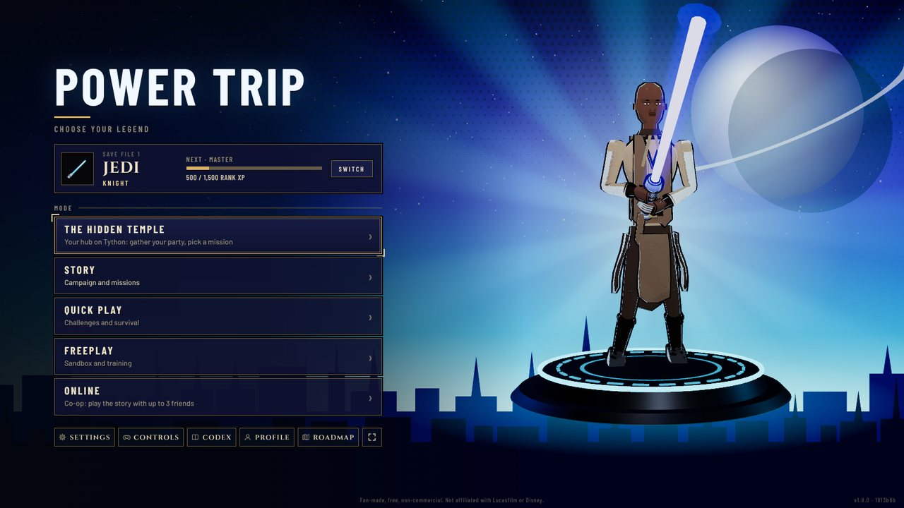
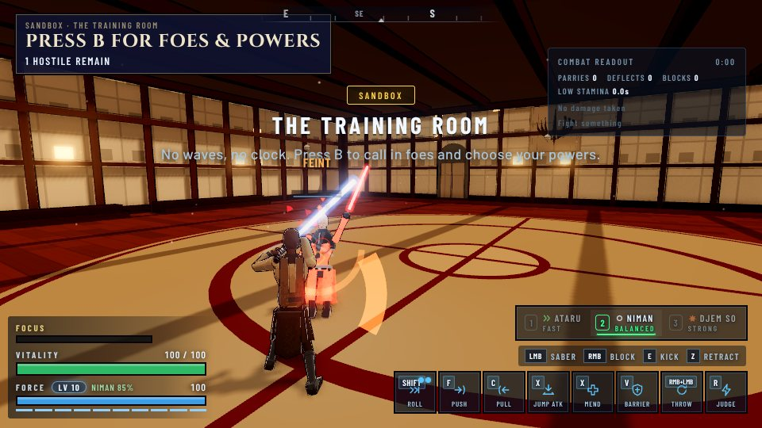
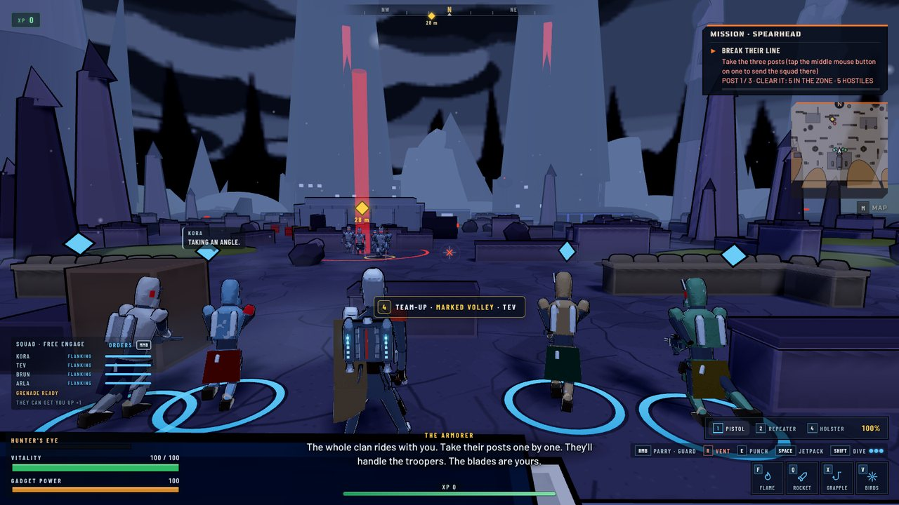
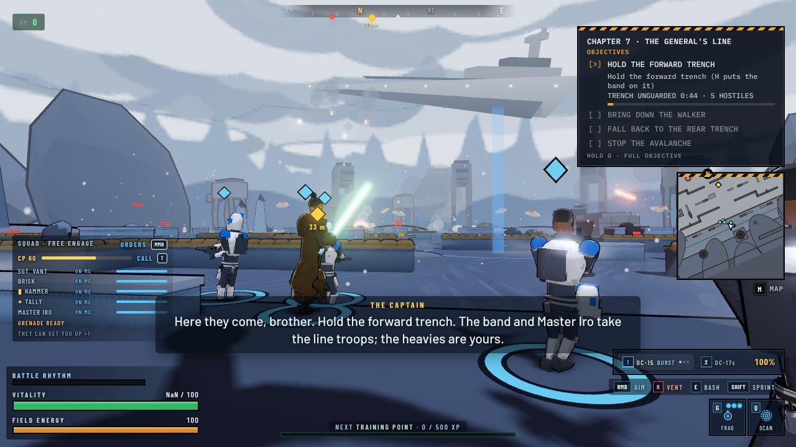
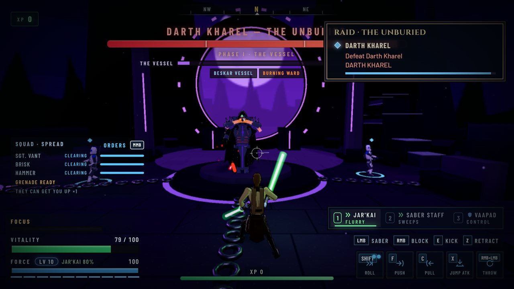
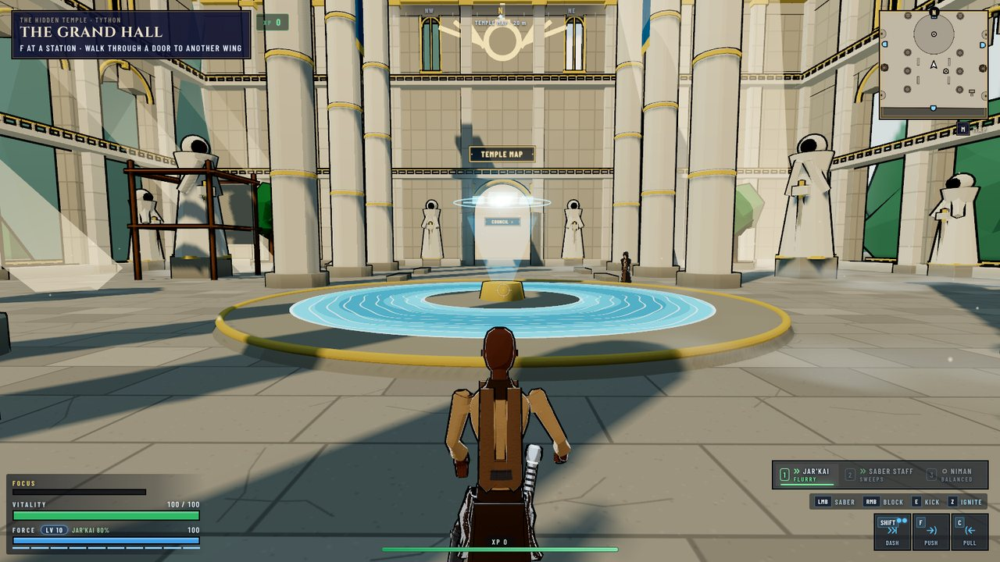
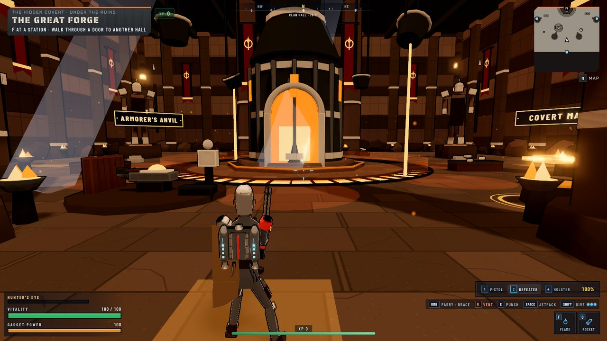
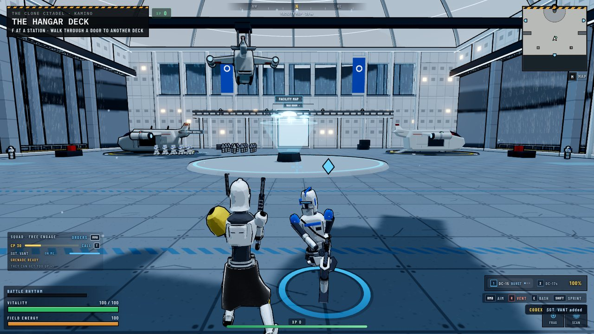
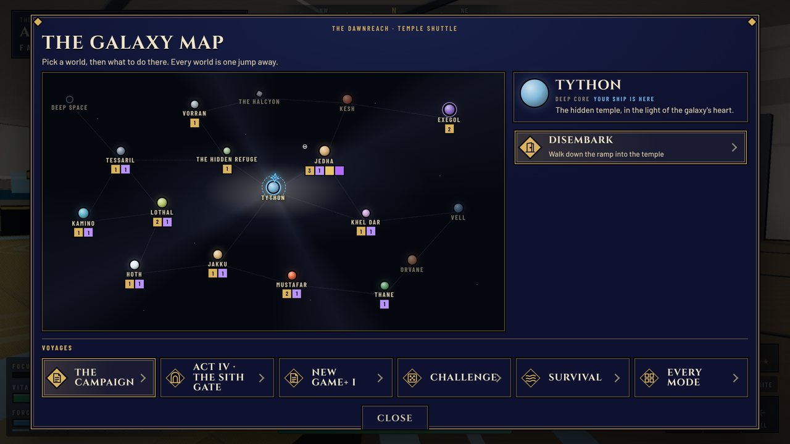

# POWER TRIP

A Star Wars-inspired third-person action game that runs in the browser, built with [Three.js](https://threejs.org/).
Play as a **Jedi**, a **Mandalorian** or a clone **ARC trooper**, each with a three-act story of their own, then team up
online with up to three friends. There are no asset files: every mesh is procedural and every sound is synthesized.

**Play it:** [sw-power-trip.vercel.app](https://sw-power-trip.vercel.app) · or get the Windows app from
[Releases](https://github.com/czinabu/power-trip/releases)



| | |
|---|---|
|  |  |
| **Jedi:** lightsaber forms, directional guards, feints and the Force | **Mandalorian:** blasters, jetpack, beskar and his clan |
|  |  |
| **ARC trooper:** cover combat and a squad to command | **Raids and co-op:** up to four heroes online |

## The game

**Three heroes, three campaigns.** Each hero has their own story from prologue to finale, told in cutscenes on set,
with choices that move a light/dark meter. Beating any campaign opens **Act IV: The Sith Gate**, a shared act for
any mix of one to four heroes.

- **Jedi:** the classic lightsaber forms (plus saber staff, Jar'Kai and reverse grip), light and heavy cuts, a
  directional guard, feints, saber locks and finishers, Force powers that grow with your Force Level, and cuts that
  land where they hit. Holster the saber to fight hand-to-hand with the Force.
- **Mandalorian:** blasters, a disruptor, the flamethrower and the Darksaber, a jetpack he earns in Act I, a beskar
  parry, close-quarters brawling and a clan of Mandalorians at his back.
- **ARC trooper:** cover-based gunfights, a modular DC-15 and a squad of clones to command, with specialists and a
  second-in-command.

**Places to be between fights.** Each hero has a hub (the Jedi's hidden temple on Tython, the Mando's covert, the
clone citadel on Kamino) that grows back to life as you play, a ship with a galaxy map, and two open zones to roam:
the old city of Jedha and the ruins past the Sith gate.



| | |
|---|---|
|  |  |

**Modes.** From the title screen:

| Menu | What's there |
|---|---|
| **Hub** | Walk your hero's hub: its stations launch every mode, raid bosses, the codex, your profile and the workbenches |
| **Story** | Each hero's campaign (13 chapters in three acts), Act IV, and the Missions page (story and side missions, remixes, medals) |
| **Quick Play** | Challenges (random missions on any map, for any hero) and Survival's endless waves |
| **Freeplay** | The sandbox (spawn anything, battle simulator, duel practice) and Training's lesson board |
| **Online** | Co-op for up to four over a 5-letter room code: the story, missions, raids, open zones, and 1v1 saber duels |

**Progress that carries.** One save file (up to three per device) keeps each hero's rank, upgrade tree, saber parts,
armour, looks and story progress, and everything you earn counts in every mode. Beaten campaigns open New Game+ and
post-game ranks.



**Controls.** Keyboard and mouse or a controller. The in-game **CONTROLS** page lists every key for the hero you're
playing. `P` cycles graphics quality anywhere, and `M` opens the map in hubs, open zones and the big story maps.

## Running it

Needs [Node.js](https://nodejs.org/) 22 or newer.

```sh
npm install        # once
npm run dev        # play at the printed localhost URL; reloads as you edit
npm run build      # writes dist/index.html, one self-contained file you can double-click or share
npm run preview    # serves the built dist/ folder
```

Opening the source `index.html` directly does not work (browsers block module imports from `file://`); use
`npm run dev`, or open the built `dist/index.html`.

`window.GAME` in the browser console exposes the config tables and most game functions for live tweaking. The dev
server also hosts the labs: `/tools/model-lab.html` (hero models and poses), `/tools/sound-lab.html` (every sound and
score) and `/tools/progression-lab.html` (prices against what a campaign pays out).

### Testing

Every pull request builds the game and runs the core smoke suites in GitHub Actions (`.github/workflows/check.yml`):
the scripted fight for each hero, the co-op connections and shared runs, cutscenes, every battle map and the
collision audit. A red check means the game failed to build or threw an error mid-fight.

Locally, run only the suites that cover what you changed. They play the **built** game headlessly, so build first:

```sh
npx playwright install chromium   # once
npm run build
npm run smoke          # a short fight as each hero
npm run smoke:coop     # two browsers connect for online co-op (see package.json for the other smoke:coop-* suites)
npm run smoke:saves    # save files, load and autosave
npm run smoke:maps     # a short fight on each battle map, and what each one costs to draw
npm run smoke:collision  # no build needed: every map, hub and zone, for props you could walk or fall through
```

`package.json` lists every suite (`smoke:*`), the combat sims (`sim:*`), perf probes (`perf*`) and
`balance:check`. `npm run build` also runs `roadmap:check` first.

### Windows desktop app

The same game ships as a Windows `.exe`: an [Electron](https://www.electronjs.org/) window around the built
`dist/index.html` (see `desktop/`). Nothing in the game changes for it.

- **Releases:** the **Desktop release** workflow checks every 3 hours and publishes a new
  [GitHub Release](https://github.com/czinabu/power-trip/releases) if anything was merged into `main` since the last
  one (or run it by hand from the Actions tab). The installed copy updates itself in the background; the portable
  `.exe` shows a notice and opens the release page.
- **A one-off build of any branch:** Actions → **Desktop build** → **Run workflow**, then download
  **PowerTrip-windows** from the run. It isn't code-signed, so SmartScreen asks once: **More info → Run anyway**.
- **Locally:** `npm run desktop` builds and opens the app; `npm run desktop:exe` writes the `.exe` files to
  `desktop/release/` (on Windows); `npm run desktop:prepare && npm run smoke:desktop` checks the app loads and its
  co-op connects to a browser (on Linux, wrap it in `xvfb-run -a`).
- Saves live in the app's own profile. Co-op works between the app and the website.

### Deploys

`main` deploys to [sw-power-trip.vercel.app](https://sw-power-trip.vercel.app) on Vercel. Pull request branches only
build a Vercel preview when the commit message contains `[preview]` (`tools/vercel-ignore.sh`), so put it on the
final push of a PR that's ready to look at.

## Project layout

```
index.html        HUD and menu markup; loads styles/ and src/main.js
styles/           CSS by area (HUD, menus, hubs, profile, codex…), with per-hero themes in styles/heroes/
src/
  main.js         imports every module in load order, runs the main loop, exposes window.GAME
  state.js        G (run state), player, entity arrays, keys, and `shared` (values that get reassigned)
  data/           tuning and content tables: heroes, forms, enemies, levels, missions, campaigns, cutscene words,
                  upgrades, looks, co-op… (balance changes usually only touch this folder)
    roadmap/      the in-game roadmap, one file per entry (see its README)
  engine/         renderer and post-processing, quality, input, camera, rumble, save files
  audio/          synthesized sound bank, ambience loops and the adaptive score
  fx/             particles, blade glow and trails, one-shot VFX, the wider battle past a map's edge
  player/         the hero: movement and parkour, animation, damage, models (model/), and each hero's kit
                  (jedi/, mando/, trooper/)
  enemies/        enemy meshes, AI, pathing, duellists, attack turns, blaster bolts
  allies/         squads, apprentices and hero allies
  boss/           the bosses
  net/            online co-op over WebRTC: sessions, the partner's pose, shared foes, runs and duels
  world/          arenas and maps, hubs, open zones, skies, collision, hazards
  game/           game flow: campaign, missions and objectives, cutscenes, hubs, survival, sandbox, training,
                  saves, progression, run state (run-state.js)
  ui/             HUD, menus, profile, codex, map, controls, the sandbox panel
api/turn.js       Vercel function that hands out TURN relay credentials for co-op
desktop/          the Windows app (Electron)
tools/            smoke suites (smoke/), screenshot scripts (shots/), combat sims, labs, mocap converter, checks
docs/             design and developer guides (below), and the README screenshots
archive/          the old single-file versions (0.1 to 2.9); each still opens with a double-click
```

Each source file starts with a one-line description of what it does.

## Docs

- [docs/development.md](docs/development.md): how the code fits together, and where to make common changes
- [docs/state-machines.md](docs/state-machines.md): screens and level phases (use `setScreen` / `setPhase`)
- [docs/animation-guidelines.md](docs/animation-guidelines.md), [docs/vfx-guidelines.md](docs/vfx-guidelines.md),
  [docs/world-guidelines.md](docs/world-guidelines.md), [docs/level-design.md](docs/level-design.md),
  [docs/enemy-ai.md](docs/enemy-ai.md), [docs/hero-ui.md](docs/hero-ui.md)
- [CLAUDE.md](CLAUDE.md): house rules for contributors (roadmap entries, shared lists, state changes)

## Tech

- **Three.js** (r160, pinned) from npm, with an EffectComposer pipeline (ambient occlusion, light shafts, bloom and
  a per-world colour grade)
- **Web Audio API** for all sound: procedural synthesis, no audio files
- **Vite**, with `vite-plugin-singlefile` to inline everything into one HTML file
- **PeerJS / WebRTC** for online co-op, with optional Cloudflare TURN relays
- **Electron** for the Windows app; **Playwright** for the smoke suites
- Motion capture: the data used in this project was obtained from [mocap.cs.cmu.edu](http://mocap.cs.cmu.edu). The
  database was created with funding from NSF EIA-0196217.
- Built with the assistance of [Claude Code](https://claude.ai/code)

Fan-made, free and non-commercial. Not affiliated with Lucasfilm or Disney.

## License

Copyright (c) 2026 Caleb Zinabu. All rights reserved. See [LICENSE](LICENSE) for details.
